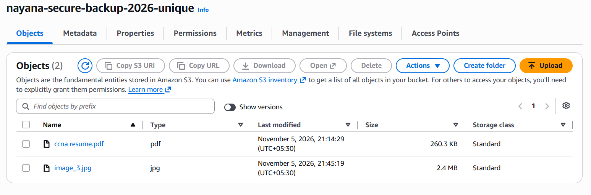
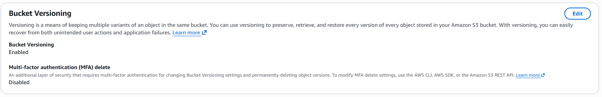
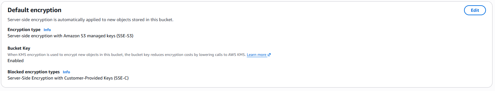
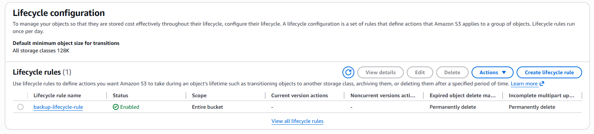
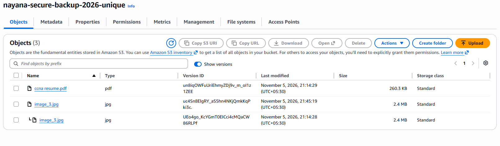

# Secure File Storage and Backup Management Using Amazon S3

## 1. Project Overview
This project demonstrates secure file storage and backup management using Amazon Simple Storage Service (Amazon S3). It uses S3 features such as versioning, server-side encryption, lifecycle management, and public access blocking to protect stored files and support file recovery.

## 2. Project Objectives
- Store files securely in Amazon S3.
- Enable versioning to maintain previous file versions.
- Protect stored data using server-side encryption.
- Configure lifecycle rules for storage cleanup.
- Prevent unauthorized public access.
- Test file recovery using S3 Versioning.

## 3. AWS Services and Features Used
- **Amazon S3:** Object storage for PDF and image files.
- **S3 Versioning:** Maintains multiple versions of uploaded objects.
- **SSE-S3 Encryption:** Protects stored objects using S3-managed encryption keys.
- **S3 Lifecycle Rules:** Cleans up expired delete markers and incomplete multipart uploads.
- **Block Public Access:** Prevents public access to the bucket.

## 4. Implementation Steps
1. Created an S3 bucket in the Mumbai region.
2. Uploaded PDF and image files.
3. Enabled S3 Bucket Versioning.
4. Configured default encryption using SSE-S3.
5. Created a lifecycle rule for expired delete markers and incomplete multipart uploads.
6. Enabled Block Public Access.
7. Tested file recovery by deleting an image and restoring it using its previous version.

## 5. Project Screenshots

### 1. S3 Bucket and Uploaded Objects

### 2. S3 Versioning

### 3. S3 Encryption

### 4. S3 Lifecycle Rule

### 5. S3 File Recovery

## 6. Project Outcome
Successfully configured a secure S3 storage environment, enabled file version history, tested file recovery, and implemented basic storage cleanup and access protection.

## 7. Skills Gained
Amazon S3, Cloud Storage, Data Protection, Versioning, Encryption, Lifecycle Management, and AWS Console.
